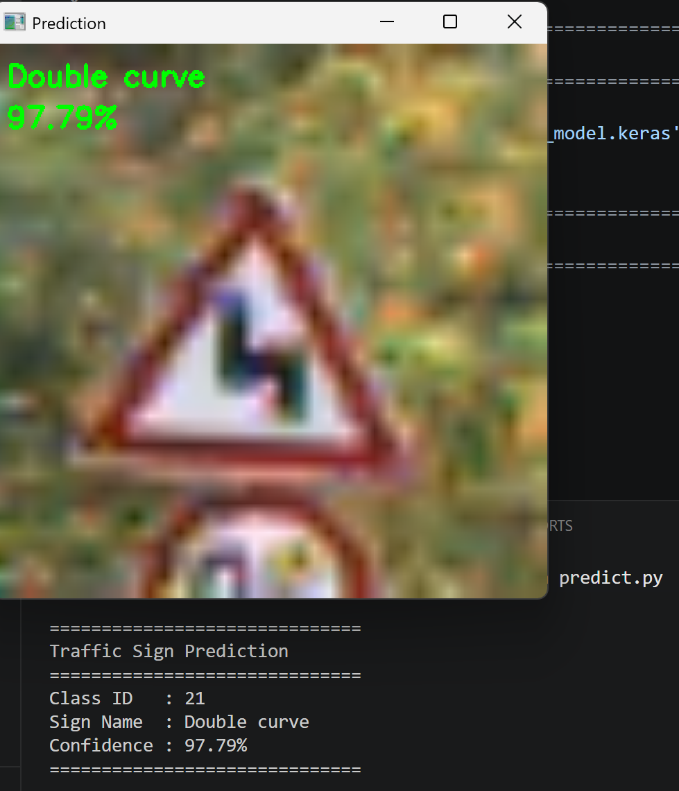
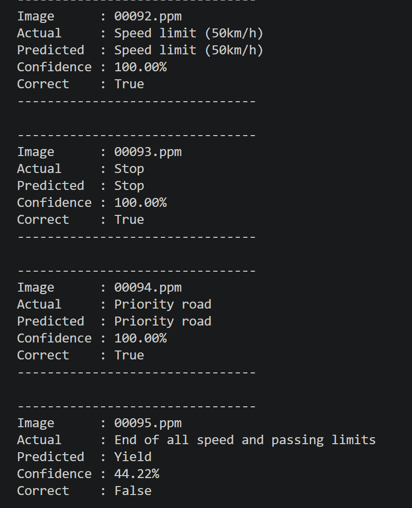

# Traffic Sign Recognition System

CNN-based traffic sign classifier trained on the German Traffic Sign Recognition Benchmark (GTSRB), achieving ~99% test accuracy.

## Demo




## Run it in your browser

`web/` is a static version that runs the same model client-side with TensorFlow.js: no server, no cold start, and images never leave the device. The preprocessing (OpenCV resize, grayscale, scikit-image CLAHE) is ported to JavaScript and verified bit-exact against the Python pipeline (`web/verify/`).

Preview locally with `cd web && python -m http.server`, or deploy on Vercel with **Root Directory** set to `web` (framework preset "Other", no build command).

## Tech Stack

- Python 3.10+
- TensorFlow / Keras
- OpenCV
- NumPy
- Scikit-image

## Project Structure

```
traffic-sign-recognition/
├── config.py            # Central configuration (paths, hyperparameters)
├── data_loader.py       # Load pickle dataset files
├── preprocess.py        # Grayscale, normalization, histogram equalization
├── augment.py           # Flip and geometric augmentation
├── model.py             # CNN architecture with multi-scale skip connections
├── train.py             # Two-stage training pipeline
├── evaluate.py          # Test accuracy and error visualization
├── predict.py           # Single image prediction with OpenCV display
├── batch_predict.py     # Batch prediction on test set
└── convert_dataset.py   # Convert raw GTSRB images to pickle format
```

## Dataset

Download the raw GTSRB dataset from:
https://benchmark.ini.rub.de/gtsrb_news.html

Extract into the `dataset/` folder, then convert:

```bash
python convert_dataset.py
```

This generates `train.p`, `valid.p`, `test.p` in the `dataset/` folder.

## Setup

```bash
# Create virtual environment
python -m venv venv
venv\Scripts\activate        # Windows
source venv/bin/activate     # Mac/Linux

# Install dependencies
pip install -r requirements.txt
```

## Training

```bash
python train.py
```

Training runs in two stages:
- **Stage 1** — Pre-trains on a 20× augmented extended dataset
- **Stage 2** — Fine-tunes on a balanced dataset (equal samples per class)

Best model is saved automatically as `stage2.keras`.

## Evaluation

```bash
python evaluate.py
```

Prints test accuracy and saves a visualization of misclassified images.

## Prediction

Single image:
```bash
python predict.py
```

Batch prediction on test set:
```bash
python batch_predict.py
```

## Model Architecture

- 4 Conv blocks (32 → 64 → 128 → 256 filters) with Batch Normalization
- Multi-scale skip connections from all conv layers
- Dense 1024 with 50% Dropout
- Output: 43 classes (Softmax)

## Configuration

All key settings are in `config.py`:

```python
DATASET_DIR = 'dataset'
BATCH_SIZE  = 128
LR_STAGE1   = 1e-3
LR_STAGE2   = 1e-4
MULTIPLIER  = 20
PER_CLASS   = 20_000
```

## License

MIT
